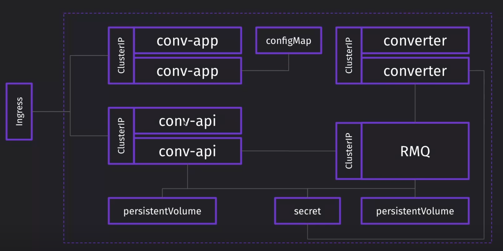

# Конфигурации Kubernetes

## conv_api

**Манифесты Converter API**:

1. Kubernetes Service ClusterIP (для доступа к приложению внутри кластера)
2. Kubernetes Deployment (API приложения)
3. Kubernetes PersistentVolumeClaim (запрос хранилища - для сохраненных преобразованных фотографий)
4. Kubernetes Secret (секреты - для доступа к очереди на выполнение конвертаций)

## conv_app

**Манифесты Converter App**:

1. Kubernetes Service ClusterIP (для доступа к приложению внутри кластера)
2. Kubernetes Deployment (frontend конвертера изображений)
3. Kubernetes Ingress на базе nginx (для маршрутизацией трафика с заданного домена (conv.test) на frontend-приложение)
4. Kubernetes Service NodePort (для отладочного и демонстрационного доступа к приложению извне кластера)
5. Kubernetes ConfigMap (frontend настройки)

## conv_service

**Манифесты Converter Service**:

1. Kubernetes Service ClusterIP (для доступа к приложению внутри кластера)
2. Kubernetes Deployment (основная бизнес-логика конвертера изображений)

## rabbitmq

**Манифесты очереди сообщений**:

1. Kubernetes Service ClusterIP (для доступа к приложению внутри кластера)
2. Kubernetes Deployment (очередь сообщений RabbitMQ)
3. Kubernetes PersistentVolumeClaim (запрос хранилища - для сохранения данных очереди отправленных запросов на изменение фотографий)
